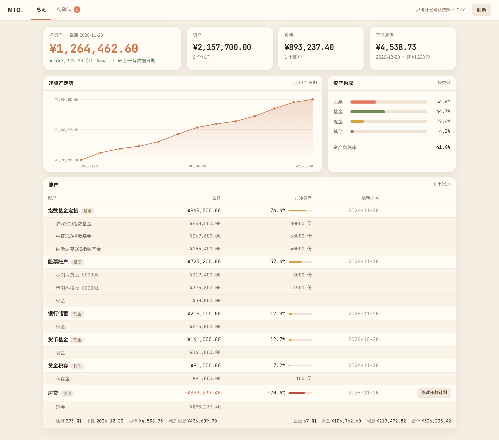
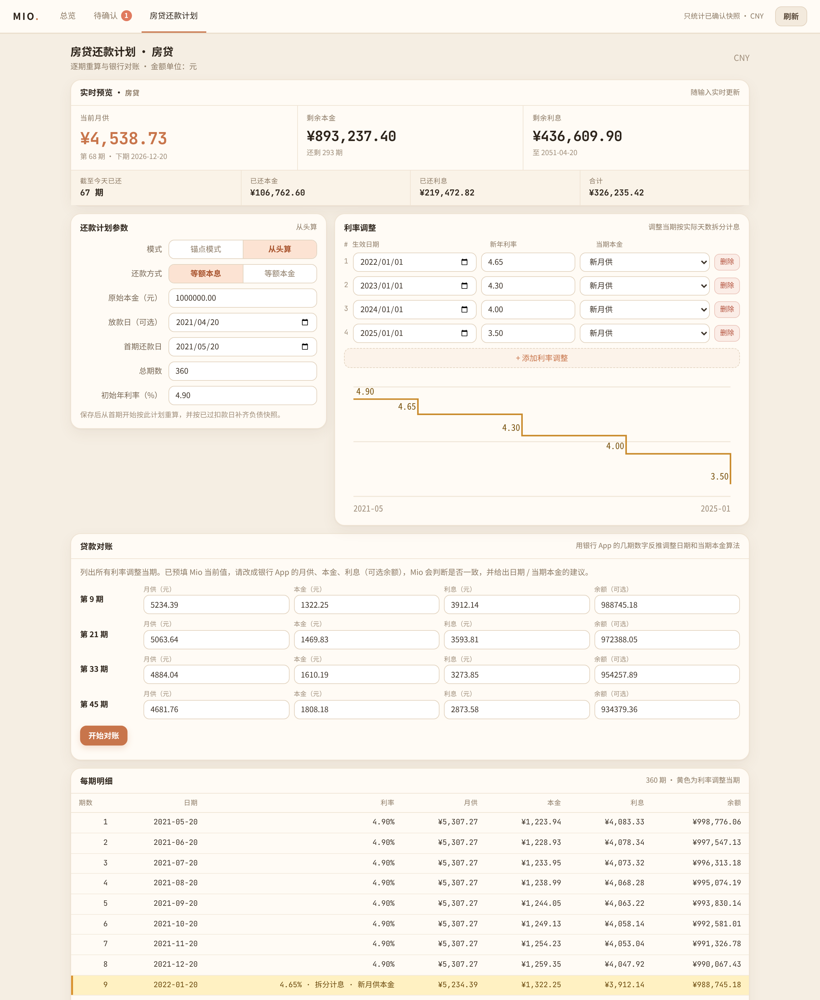

<p align="center">
  <a href="README.md">中文</a> · <a href="README.en.md">English</a>
</p>

<p align="center">
  
</p>

<h1 align="center">Mio Money</h1>

<p align="center">
  <strong>Money in One</strong>: bring scattered household assets into one place, and let your own AI agent read, write, and analyze them over MCP.
</p>

<p align="center">
  <a href="https://go.dev/"></a>
  <a href="LICENSE"></a>
  <a href="docs/mcp-v1.md"></a>
  <a href="https://wails.io/"></a>
  
</p>

<p align="center">
  <a href="#highlights">Highlights</a> ·
  <a href="#quick-start">Quick start</a> ·
  <a href="#mcp">MCP</a> ·
  <a href="#design">Design</a> ·
  <a href="#roadmap">Roadmap</a> ·
  <a href="#license">License</a>
</p>

## Screenshots

<p align="center">
  
</p>

<p align="center"><sub>Overview · net worth, asset allocation, history and accounts</sub></p>

<p align="center">
  
</p>

<p align="center"><sub>Loan plan · live preview, rate changes, bank reconciliation and period detail</sub></p>

## Highlights

- **Local-first**: everything lives in one SQLite file. Money is always integer cents; quantities are decimal strings, so floating-point error never enters the ledger.
- **Agent-native**: MCP over stdio or Streamable HTTP. HTTP requires a bearer token and a source CIDR allowlist, listens on loopback by default, and expires idle sessions after 30 minutes.
- **Writes with brakes**: an agent first calls `submit_snapshot` for a diff preview, then `confirm_snapshot` to make it live. Large total changes, disappearing positions, negative values and currency mismatches are blocked and wait for a human in the desktop "pending" view.
- **Loan replay**: model a loan from an anchor date or replay it from period 1. It supports 30-day split interest, three principal rules for rate-change periods, and prepayments. `--loan-sync` writes liability snapshots for elapsed payment dates.
- **Bank reconciliation**: copy a few monthly payment, principal and interest figures from the bank app; `reconcile_loan_history` infers the rate-change date and principal rule. Reconciliation is read-only; write only after you confirm.
- **Fund E-account import**: read xlsx or encrypted zip files in the desktop app, map trade accounts to accounts/portfolios, review diffs, and write through the existing snapshot confirmation flow. Targets can be imported one by one; confirmed imports can be undone by snapshot. See [`docs/efund-import.md`](docs/efund-import.md).
- **One clear overview**: net worth, assets and liabilities, history chart, asset allocation, and per-loan remaining periods, next payment and paid totals in the desktop app.

## Quick start

You need Go 1.26+. The desktop app is built with Wails v3 and currently targets macOS first.

```sh
git clone https://github.com/curiselven/mio-money.git
cd mio-money

# macOS installer (builds Mio.app and the CLI, backs up the database, archives the old app)
./scripts/install-mac.sh --dry-run
./scripts/install-mac.sh

# Or build manually
go build -o bin/mio ./cmd/mio
go build -o bin/mio-desktop ./cmd/mio-desktop

# Desktop app (temporary demo database; the default database is untouched)
./bin/mio-desktop --db /tmp/mio-demo.db

# Preview the desktop app with fake data in a browser and take screenshots (no app, no database; needs Chrome/Chromium)
./scripts/ui-preview/shoot.sh

# Write liability snapshots for elapsed payment dates, print a JSON summary and exit
./bin/mio --db /tmp/mio-demo.db --loan-sync

# Watch one complete MCP stdio round trip (temporary directory and fake data)
go run ./examples/stdio-demo
```

`scripts/install-mac.sh` builds `Mio.app` and the CLI, backs up the database (including wal/shm) with mode 0600, archives the previous app and ad-hoc signs the bundle. `--dry-run` prints the steps only; see [`scripts/install-mac.sh`](scripts/install-mac.sh). The UI preview captures `home`, `import`, `import-done`, `accounts` and `pending`; see [`scripts/ui-preview/README.md`](scripts/ui-preview/README.md) for manual preview.

The default database is `~/Library/Application Support/MioMoney/mio.db` on macOS (`~/.config/MioMoney/mio.db` on Linux). Pass `--db` to use another file. `mio` runs over stdio by default and is normally started by an MCP client; running it directly waits for stdin.

### Common flags

| Flag | Default | Description |
|---|---|---|
| `--db` | `MioMoney/mio.db` under the user config directory | SQLite file path |
| `--max-change` | `20` | Block confirmation when an account total moves more than this percentage |
| `--http` | `false` | Serve MCP over Streamable HTTP instead of stdio |
| `--addr` | `127.0.0.1:7420` | HTTP listen address |
| `--allow` | `127.0.0.1/32,::1/128` | Comma-separated CIDRs allowed to connect |
| `--session-idle` | `30m` | Idle HTTP MCP session lifetime; must be greater than 0 |
| `--loan-sync` | `false` | Sync loan snapshots, print a JSON summary and exit |

The desktop app also accepts `--db` and `--max-change`, and uses the same database as MCP by default.

### Desktop pages

The desktop app has Overview, Pending, Import · Fund E-account, Accounts and Loan pages. Accounts are at most two levels deep: portfolios sit under an account, and snapshots can be written to either. A portfolio inherits its parent's type, currency and owner; change the owner on the account only. The Accounts page creates/renames accounts and portfolios and archives empty ones. The new-account, new-portfolio and edit forms start collapsed, and an account with no portfolios shows no empty-portfolio copy. Home-page account details start collapsed, and each account tree shows its share of total assets as "占总资产" (share of total assets). The import done state summarizes applied, pending, ignored and skipped groups, with undo for this import and a shortcut to Pending.

See [`docs/design-system.md`](docs/design-system.md) for tokens and components, and [`docs/efund-import.md`](docs/efund-import.md) for import steps, mapping, pending review and undo.

## MCP

### stdio

Point your agent at the built binary. Add `--db` to `args` to use another database:

```json
{
  "mcpServers": {
    "mio": {
      "command": "/path/to/bin/mio",
      "args": ["--db", "/path/to/mio.db"]
    }
  }
}
```

### HTTP

Add `--http` to the same binary to serve agents on other machines:

```sh
export MIO_HTTP_TOKEN="$(openssl rand -hex 32)"

./bin/mio --http \
  --db /tmp/mio-demo.db \
  --addr 0.0.0.0:7420 \
  --allow 192.0.2.0/24 \
  --session-idle 30m
```

- It listens on `127.0.0.1:7420` by default. For remote access, listen on a non-loopback address and add the client network to `--allow`.
- Every request needs `Authorization: Bearer <token>`. Startup fails when `MIO_HTTP_TOKEN` is empty or shorter than 24 characters.
- The source IP is taken from the TCP peer, never from `X-Forwarded-For`. Logs go to stderr and never include the token.
- When `--session-idle` expires, the client handshakes again on its next request.

Client example (`192.0.2.10` is a documentation address; use your real host):

```json
{
  "mcpServers": {
    "mio": {
      "url": "http://192.0.2.10:7420",
      "headers": {
        "Authorization": "Bearer <a random token of at least 24 characters>"
      }
    }
  }
}
```

See [`docs/mcp-v1.md`](docs/mcp-v1.md) for every tool, field and anomaly rule, and [`docs/adr/0001-tech-stack.md`](docs/adr/0001-tech-stack.md) for the technical choices.

## Design

Mio does three things: **store data, validate it, and calculate**. Screenshots, broker reads and bank-app reads belong to your own agent. Mio does not store a transaction ledger; it stores snapshots of "what this account held / owed on this date", and compares snapshots to derive changes.

Money is `int64` cents, the database is a single SQLite file, and migrations are explicit SQL. Writes start as `pending` and become `confirmed` only after confirmation; anomaly rules can block confirmation until a human handles it in the desktop app. Loans use the same snapshot model: the repayment schedule generates balances, while snapshots stay undoable and auditable.

## Roadmap

- Near term: `launchd` autostart and desktop entry for prepayments.
- Not planned for V1: transaction ledger, market-data fetching, currency conversion, budgeting and cloud sync.
- The source of truth is [`docs/mcp-v1.md`](docs/mcp-v1.md) and the ADRs.

## License

[MIT](LICENSE)
