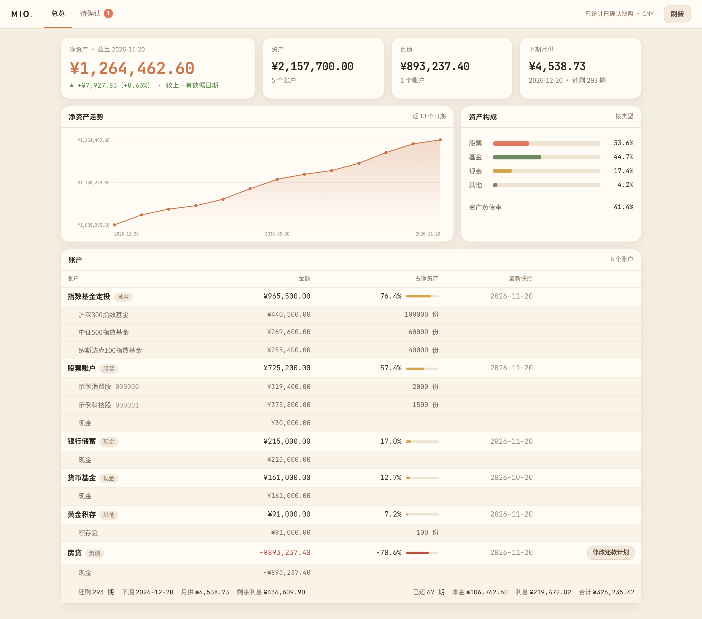
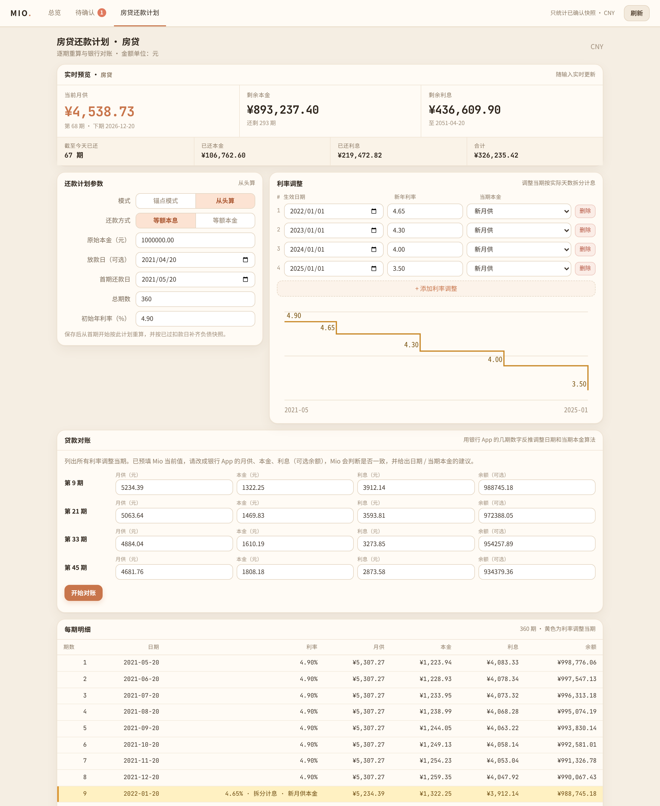

<p align="center">
  <a href="README.md">中文</a> · <a href="README.en.md">English</a>
</p>

<p align="center">
  
</p>

<h1 align="center">Mio Money</h1>

<p align="center">
  <strong>Money in One</strong>：把散落各处的家庭资产汇到一处，让你自己的 AI Agent 通过 MCP 读写和分析。
</p>

<p align="center">
  <a href="https://go.dev/"></a>
  <a href="LICENSE"></a>
  <a href="docs/mcp-v1.md"></a>
  <a href="https://wails.io/"></a>
  
</p>

<p align="center">
  <a href="#功能亮点">功能亮点</a> ·
  <a href="#快速上手">快速上手</a> ·
  <a href="#mcp-接入">MCP 接入</a> ·
  <a href="#设计理念">设计理念</a> ·
  <a href="#路线图">路线图</a> ·
  <a href="#license">License</a>
</p>

## 界面

<p align="center">
  
</p>

<p align="center"><sub>总览 · 净资产、资产构成、历史曲线与账户</sub></p>

<p align="center">
  
</p>

<p align="center"><sub>房贷 · 实时预览、利率调整、银行对账与逐期明细</sub></p>

## 功能亮点

- **本地优先**：数据只落在一个 SQLite 文件里；金额一律用整数「分」，份额用十进制字符串，不把浮点误差带进账本。
- **Agent 原生**：MCP 同时支持 stdio 和 Streamable HTTP；HTTP 需要 Bearer token 和来源 CIDR 白名单，默认只监听回环地址，空闲会话 30 分钟后自动断开。
- **写入有刹车**：Agent 先 `submit_snapshot` 拿到差异预览，再 `confirm_snapshot` 才生效；总额突变、持仓整条消失、负数、币种不一致会被拦截，并在桌面端「待确认」里等人放行。
- **房贷逐期重算**：既可以从某个锚点开始算，也可以从第 1 期完整重放；支持 30 天拆分计息、调整当期的三种本金算法和提前还款。`--loan-sync` 会按已过扣款日自动补写负债快照。
- **和银行对账**：抄几期银行 App 的月供、本金、利息，`reconcile_loan_history` 会反推利率调整的生效日和当期本金算法；对账只读，确认后再写入。
- **一眼看懂**：桌面端提供净资产、资产/负债、历史曲线、资产构成，以及每笔贷款还剩多少期、下期月供和已还合计。

## 快速上手

需要 Go 1.26+。桌面端基于 Wails v3，当前以 macOS 为主要目标。

```sh
git clone https://github.com/curiselven/mio-money.git
cd mio-money

# 构建
go build -o bin/mio ./cmd/mio
go build -o bin/mio-desktop ./cmd/mio-desktop

# 桌面端（用临时库演示，不会碰默认数据库）
./bin/mio-desktop --db /tmp/mio-demo.db

# 补写已过扣款日的贷款负债快照，打印 JSON 摘要后退出
./bin/mio --db /tmp/mio-demo.db --loan-sync

# 看一次完整的 MCP stdio 往返（临时目录 + 假数据，结束后清理）
go run ./examples/stdio-demo
```

默认数据库位于 macOS 的 `~/Library/Application Support/MioMoney/mio.db`（Linux 为 `~/.config/MioMoney/mio.db`），用 `--db` 可以指向其他文件。`mio` 默认以 stdio 模式运行，通常由 MCP 客户端启动；直接在终端运行会等待 stdin 输入。

### 常用参数

| 参数 | 默认值 | 说明 |
|---|---|---|
| `--db` | 系统配置目录下的 `MioMoney/mio.db` | SQLite 文件路径 |
| `--max-change` | `20` | 账户总额变化超过该百分比时拦截确认 |
| `--http` | `false` | 用 Streamable HTTP 代替 stdio |
| `--addr` | `127.0.0.1:7420` | HTTP 监听地址 |
| `--allow` | `127.0.0.1/32,::1/128` | 允许连接的 CIDR，逗号分隔 |
| `--session-idle` | `30m` | HTTP MCP 空闲会话过期时间，必须大于 0 |
| `--loan-sync` | `false` | 同步贷款快照、输出 JSON 摘要并退出 |

桌面端另外支持 `--db` 和 `--max-change`，默认与 MCP 使用同一个数据库。

## MCP 接入

### stdio

把构建好的二进制配进 Agent 即可。需要换数据库时在 `args` 里加 `--db`：

```json
{
  "mcpServers": {
    "mio": {
      "command": "/path/to/bin/mio",
      "args": ["--db", "/path/to/mio.db"]
    }
  }
}
```

### HTTP

同一个二进制加 `--http`，可以给其他机器上的 Agent 使用：

```sh
export MIO_HTTP_TOKEN="$(openssl rand -hex 32)"

./bin/mio --http \
  --db /tmp/mio-demo.db \
  --addr 0.0.0.0:7420 \
  --allow 192.0.2.0/24 \
  --session-idle 30m
```

- 默认只监听 `127.0.0.1:7420`；要从其他机器访问，需要显式监听非回环地址并把对方网段加入 `--allow`。
- 每个请求都要带 `Authorization: Bearer <token>`；`MIO_HTTP_TOKEN` 为空或短于 24 个字符时拒绝启动。
- 来源 IP 只取 TCP 对端地址，不信任 `X-Forwarded-For`。日志写到 stderr，不记录 token。
- `--session-idle` 到期后会话失效，客户端下次请求会重新握手。

客户端配置示例（`192.0.2.10` 是文档保留地址，请换成实际地址）：

```json
{
  "mcpServers": {
    "mio": {
      "url": "http://192.0.2.10:7420",
      "headers": {
        "Authorization": "Bearer <至少 24 个字符的随机 token>"
      }
    }
  }
}
```

完整工具列表、字段和异常规则见 [`docs/mcp-v1.md`](docs/mcp-v1.md)，技术选型见 [`docs/adr/0001-tech-stack.md`](docs/adr/0001-tech-stack.md)。

## 设计理念

Mio 只做三件事：**存数据、校验、计算**。截图、读券商、读银行 App 这类采集工作交给你自己的 Agent；Mio 不存交易流水，只存「某账户在某天持有什么 / 还欠多少」的快照，前后两份快照对比得到变化。

金额用 `int64` 分，SQLite 单文件，迁移是显式 SQL。写入默认先 `pending`、确认后才变成 `confirmed`；命中异常规则时，确认会被拒绝，必须由人在桌面端处理。贷款采用同一套快照模型，逐期计划只负责生成余额，不改变快照可撤回、可审计的规则。

## 路线图

- 近期：`launchd` 开机自启、提前还款的桌面录入。
- 暂不做：交易流水、行情抓取、汇率换算、预算记账、云同步。
- 后续方向以 [`docs/mcp-v1.md`](docs/mcp-v1.md) 和 ADR 为准。

## License

[MIT](LICENSE)
